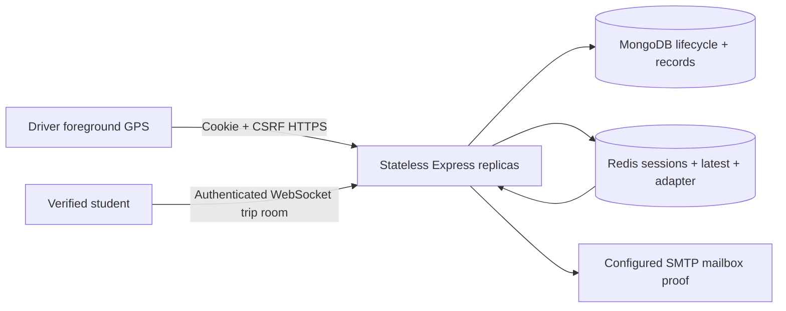

# Architecture

The app is an npm-workspace modular monolith: `@lal/web` (React/TypeScript/Vite), `@lal/api` (Express/TypeScript), and `@lal/shared` (Zod contracts/time/freshness). One origin serves web assets, HTTP API and Socket.IO. No client directly accesses MongoDB or Redis.

## Domain boundaries

- A **route** is a named service and draft textual stop description; a **bus** is an independently managed physical vehicle. Seed routes never create physical fleet inventory.
- A **schedule** records a local `HH:mm` departure and optional known service days. Unknown days stay null; departure time is not ETA or evidence that a vehicle is operating.
- A **trip** is the driver's active business lifecycle. LIVE/STALE/OFFLINE freshness is computed separately from ACTIVE/ENDED. No accepted GPS means OFFLINE.
- A **location sample** is a measured or explicitly development-simulated observation, never inferred from a timetable. Mongo GeoJSON stores `[longitude, latitude]`.

MongoDB is authoritative for users, driver approvals/assignments, buses, routes, schedules, trips and audits. Redis stores hashed opaque session identifiers, CSRF session state, bounded-TTL latest-value projections, event dedupe/rate keys, lifecycle locks and Socket.IO pub/sub. Redis failure makes readiness fail and stops safe tracking operations; it never grants a session or fakes a live bus.

## Trip consistency and privacy

Server-side assignment and approval checks precede Start. Partial unique Mongo indexes prevent simultaneous ACTIVE trips on one bus or one driver, including concurrent requests. Identical repeated starts recover the existing trip. Per-trip Redis locks plus conditional version updates serialize location/end operations. End clears the trip's latest position and Redis latest cache, emits ended status, removes subscribers from the trip room, and rejects later GPS ingestion.

Only verified STUDENT/ADMIN sessions may subscribe to live rooms. Every subscription and reconnect retrieves an authoritative snapshot; sockets are bound to session rooms, checked periodically and disconnected on expiry/logout. User roles are checked in HTTP and socket code. Public route/schedule APIs never include private GPS. Driver contact information is absent from live DTOs.

Client location reports are foreground-only and throttled around 5–10 seconds. Server validates bounds, age/skew, accuracy, plausible jumps and out-of-order samples; event IDs dedupe retries. Received timestamps determine freshness. Mongo stores current trip position and periodic historical samples; Redis fanout sends updates only to interested trip rooms.

## Index migration and retention

`npm run db:migrate` runs additive migration `001_initial_indexes` and records its application. Run this before accepting traffic. Index creation is idempotent; automatic production index builds are disabled. Do not run destructive `syncIndexes` against an existing deployment.

| Collection             | Index purpose                                                            |
| ---------------------- | ------------------------------------------------------------------------ |
| User                   | Unique normalized email                                                  |
| DriverProfile          | Unique user ID and driver identifier                                     |
| Bus                    | Unique partial known fleet/registration strings; assignment/route lookup |
| Route                  | Unique slug                                                              |
| ScheduleEntry          | Unique source key; route + direction + departure time                    |
| Trip                   | Unique bus/driver when ACTIVE; status + started time                     |
| Stop, LocationSample   | Sparse GeoJSON `2dsphere` point lookup                                   |
| LocationSample         | Trip + received time; `expireAt` TTL                                     |
| EmailVerificationToken | Unique token hash; expiry TTL                                            |
| AuditLog               | Reverse timestamp for review                                             |

`LOCATION_RETENTION_HOURS=24` sets sample expiry; MongoDB TTL deletion is asynchronous. Ended trips retain lifecycle metadata without latest coordinates. Active latest positions older than retention are cleared by the sweep. Session and cache keys expire; verification proofs are single-use and expire after 15 minutes. Audit retention is an operator policy, and backups must follow the same privacy policy; TTL alone does not delete backups.

## Scaling boundary

Socket.IO uses the Redis adapter and websocket-only transport. This avoids sticky-session requirements of HTTP polling, with the tradeoff that restrictive networks lacking WebSocket support cannot use live sockets. Public schedules have short HTTP caching; hashed assets can use a CDN. Keep private GPS/auth responses `no-store`.

Each API instance currently caps its Mongo pool at 30. Budget total pools, Redis adapter connections, file descriptors and load-balancer idle timeouts before increasing replicas. Freshness sweep leadership uses Redis; it scans active trips once per second and is an identified optimization target before very large fleets. GPS writes persist the latest trip reading to Mongo and historical points on the configured snapshot interval; benchmark resulting database write volume.

Prometheus metrics at admin-only `/api/v1/admin/metrics` expose process/default metrics, HTTP counters and latency histogram. Deploy a trusted collector with session-aware access or a separately secured internal scrape route. Bounded request bodies, report rates and room counts exist; infrastructure-level connection limits and overload alerts must still be configured. No measured 10k capacity is implied by the architecture.
